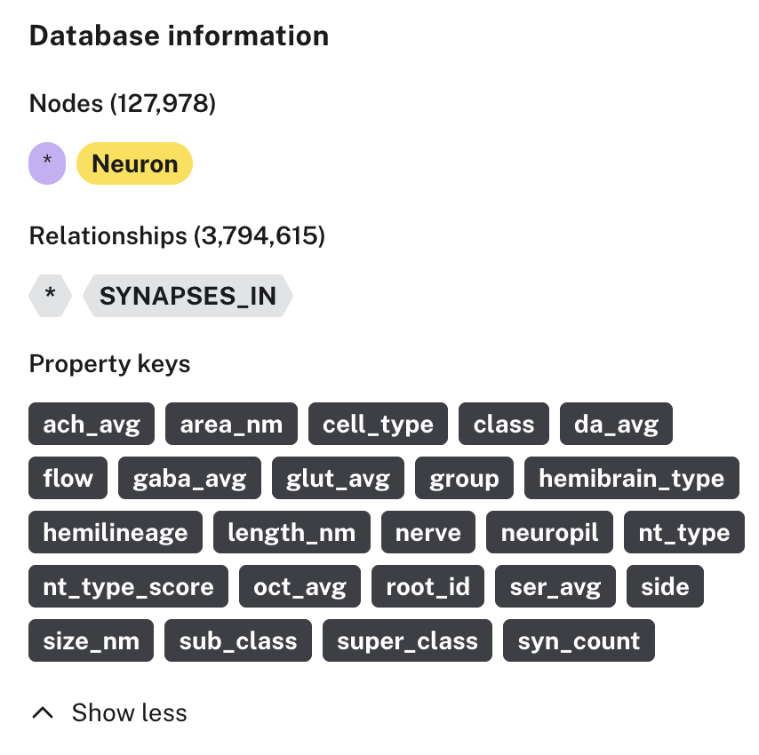
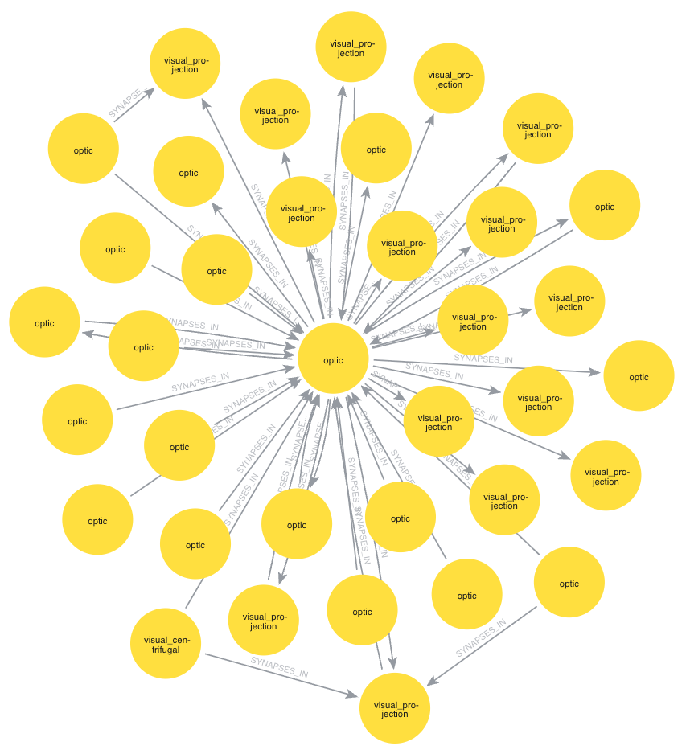

# FlyWire v630

The complete wiring diagram of an adult *Drosophila* brain, from Lin et al., [Nature 2024](https://www.nature.com/articles/s41586-024-07558-y). 127,978 neurons, 2,613,129 directed synaptic connections.

<table><tr>
<td></td>
<td></td>
</tr></table>

## Graph

Neurons are nodes. A synapse between two neurons is a directed edge, weighted by synapse count and annotated with the brain regions and neurotransmitter types involved. Each neuron is classified by cell type, brain hemisphere, signal flow direction and predicted neurotransmitter.

The paper used this connectome to study how the fly brain is organized at a network level — identifying small-world properties, rich-club structure among high-degree neurons and how different sensory pathways (visual, olfactory, mechanosensory) are wired relative to each other.

## Load

```bash
git clone https://github.com/murthylab/flywire-network-analysis
cp .env.example .env          # fill in NEO4J_URI, credentials, database
python3 download_graph.py
```
