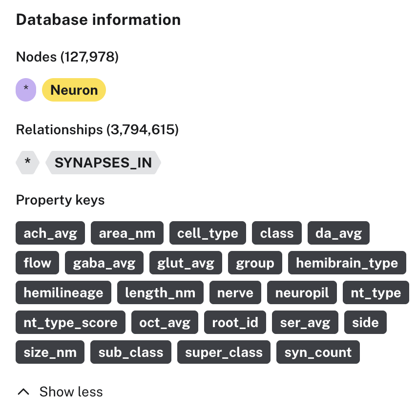

# FlyWire v630

The v630 FlyWire connectome from Lin et al., Nature 2024. `flywire_v630.dump` is the raw graph. `flywire_v630_full.dump` is the same graph plus the paper’s results.



## Graph

Each neuron is a `Neuron` node. Each row of the connections file is one `SYNAPSES_IN` relationship from the presynaptic neuron to the postsynaptic neuron, with `neuropil`, `syn_count`, and `nt_type`. The same two neurons can have several links, one per brain region.

There are 127,978 neurons and 3,794,615 links. Summing `syn_count` for each neuron pair gives 2,613,129 pairs, and every pair totals at least 5 synapses. A row can still have `syn_count` of 1–4 when that pair’s synapses are split across regions. Sum the pair first. Pairs below 5 synapses are not in this file.

The full dump adds `res_connectivity_tags`, the four whole-brain `res_` totals on each neuron, `Neuropil` nodes, and `RES_REGION_COUNTS` relationships.

## Files

- `flywire_v630.dump` is the raw graph. Upload it directly in Neo4j Desktop.
- `flywire_v630_full.dump` includes the results. Upload it the same way.
- `prepare_import.py` loads the raw graph into the database named in `.env`.

`flywire-network-analysis/` is the authors’ repository, cloned here and ignored by git. `data_products/`, `connectivity_tags.csv.gz`, and `neuropil_synapse_table.csv.gz` contain the paper’s results.

## Run

The dumps are already in this repository. To load the raw graph into your own database:

```bash
git clone https://github.com/murthylab/flywire-network-analysis
cp .env.example .env
python3 prepare_import.py
```

Set `NEO4J_URI`, `NEO4J_USERNAME`, `NEO4J_PASSWORD`, and `NEO4J_DATABASE` in `.env`. A local database uses `bolt://localhost:7687`. Aura uses `neo4j+s://<id>.databases.neo4j.io`.